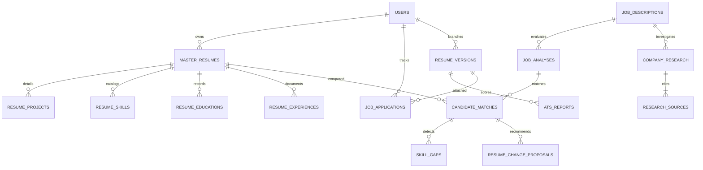

# ResumeIntel AI — Agentic AI Resume Intelligence & Customization Platform

[](#multi-agent-architecture)
[](#backend-spring-boot-architecture)
[](#python-ai-microservice)
[](#frontend-client)
[](#database-architecture)
[](LICENSE)

**ResumeIntel AI** is a production-grade, multi-agent AI system designed to solve the multi-application resume customization challenge for technical applicants. Rather than a superficial LLM wrapper or keyword-stuffing generator, ResumeIntel AI operates under an authoritative **Single Source of Truth (Master Resume)** paradigm with **9 Specialized Autonomous Agents**, **Human-in-the-Loop (HITL) Gateways**, **Verifiable Public Company Intelligence**, **RAG-backed Semantic Retrieval**, and an **Immutable Field Protection Engine**.

---

## 1. Core Problem & Product Philosophy

When candidates apply to multiple target companies for distinct roles (e.g., *Java Backend Intern* at Company A, *AI Engineer Intern* at Company B, *Full Stack Intern* at Company C), a single generic resume fails to highlight role-aligned technical strengths.

ResumeIntel AI enforces **10 Non-Negotiable Tenets**:
1. **Master Resume is the Single Source of Truth**: All customizations derive from verified candidate experience.
2. **Strict Immutability ("Air-Gap" Guard)**: Personal details (name, email, phone, location, LinkedIn, GitHub), educational institutions, degrees, GPAs, graduation dates, employer names, and employment dates **can never be automatically modified**.
3. **Mandatory Human-in-the-Loop Approvals**: Every modification is presented in an interactive diff interface with rationale, supporting JD requirement, company insight, and expected benefit.
4. **Honest Skill Gap Classification**: Missing skills are classified into 5 strict buckets (**A–E**) and questioned before inclusion—never falsely hallucinated.
5. **Verifiable Research Citations**: Company research requires direct URLs, publication dates, confidence ratings, and explicit distinction between official company requirements and observed engineering patterns.
6. **Multi-Version Tree Isolation**: Customizing a resume for Company A creates an independent version branch that never modifies Company B's version or the Master Resume.
7. **ATS Heuristic Transparency**: ATS scores are internal structural heuristics, with clear disclaimers that they are not vendor algorithm guarantees.
8. **Adversarial Quality Review**: Agent 9 operates as an independent auditor rejecting any change violating factual integrity or lacking user approval.
9. **Clean Provider Extensibility**: Clean provider abstractions for LLMs (Gemini, OpenAI, Groq, and Mock fallback) and Web Search (Tavily, DuckDuckGo, and Curated Knowledgebase).
10. **The User Has Final Authority**: The candidate maintains complete control over every resume bullet.

---

## 2. Multi-Agent Architecture (9 Autonomous Agents)

```
                       +-----------------------------------+
                       |    Uploaded PDF / DOCX Resume     |
                       +-----------------------------------+
                                         |
                                         v
                       +-----------------------------------+
                       | Agent 1: Resume Intelligence      |
                       | - Extracts structured JSON schema |
                       | - Enforces Protected Field Locks  |
                       +-----------------------------------+
                                         |
                                         v
   +-----------------------------------------------------------------------------------+
   |                               PARALLEL STAGE 1                                    |
   |                                                                                   |
   |  +-----------------------------+               +-------------------------------+  |
   |  | Agent 2: JD Analysis        |               | Agent 3: Company Research     |  |
   |  | - Mandatory vs Preferred    |               | - Live Web Search (Tavily/DDG)|  |
   |  | - Technical skill taxonomy  |               | - Verifiable URL citations    |  |
   |  | - Seniority & keywords      |               | - Stack & culture patterns    |  |
   |  +-----------------------------+               +-------------------------------+  |
   +-----------------------------------------------------------------------------------+
                                         |
                                         v
                       +-----------------------------------+
                       | Agent 4: Candidate Matching       |
                       | - Multi-factor alignment matrix   |
                       | - Transparent component scoring   |
                       | - Zero skill hallucinations       |
                       +-----------------------------------+
                                         |
                                         v
                       +-----------------------------------+
                       | Agent 5: Skill Gap & Verification |
                       | - 5-Category Classification (A-E) |
                       | - Formulates candidate questions  |
                       +-----------------------------------+
                                         |
                                         v
                       +-----------------------------------+
                       | Agent 6: Project Optimization     |
                       | - STAR method reframing           |
                       | - Metrics & implementation depth  |
                       +-----------------------------------+
                                         |
                                         v
                       +-----------------------------------+
                       | Agent 7: Resume Customizer        |
                       | - Role-tailored summary hook      |
                       | - Skill & project re-ranking      |
                       +-----------------------------------+
                                         |
                                         v
   =====================================================================================
   >>> HUMAN-IN-THE-LOOP APPROVAL CHECKPOINT (User Decides Every Proposal) <<<
   =====================================================================================
                                         |
                                         v
                       +-----------------------------------+
                       | Apply Strictly Approved Changes   |
                       +-----------------------------------+
                                         |
                                         v
                       +-----------------------------------+
                       | Agent 8: ATS Optimization         |
                       | - Keyword density & repetition    |
                       | - Single-column parsing check     |
                       | - Internal heuristic indicator    |
                       +-----------------------------------+
                                         |
                                         v
                       +-----------------------------------+
                       | Agent 9: Quality Reviewer         |
                       | - Adversarial factual audit       |
                       | - Detects immutability violations |
                       | - Verifies human approval status  |
                       +-----------------------------------+
                                         |
                                         v
                       +-----------------------------------+
                       | Document Engine & Export          |
                       | - ATS Single-Column PDF Export    |
                       | - Professional DOCX Export        |
                       | - Save to Isolated Version Tree   |
                       +-----------------------------------+
```

---

## 3. Technology Stack

### Frontend Client
- **React 18** with **Vite** and **TypeScript**
- **Tailwind CSS** with premium dark SaaS design
- **Lucide Icons**
- **Responsive Navigation**: Dashboard, Master Resume, New Job Analysis, Company Intelligence, Resume Studio (HITL Diff), Applications Kanban, Version History.

### Backend Orchestration Gateway
- **Java 21** & **Spring Boot 3.3.4**
- **Spring Security** with stateless **JWT Authentication**
- **Spring Data JPA** & **Hibernate**
- **PostgreSQL 16** with **pgvector**
- **MasterResumeGuard**: Domain-level interceptor asserting protected field immutability.

### AI Microservice & Multi-Agent Layer
- **Python 3.12+** & **FastAPI**
- **LangChain** & **LangGraph** (Stateful orchestration, checkpointing, HITL pause points)
- **Pydantic v2** (Strict schema enforcement)
- **PyMuPDF (fitz)** & **python-docx** (Document extraction)
- **ReportLab** & **python-docx** (Single-column ATS-compliant PDF & Word generation)
- **RAG Vector Search** with isolated tenant filtering (`WHERE user_id = :userId`)

---

## 4. Database Schema (PostgreSQL + pgvector)



---

## 5. Quick Start & Execution Guide

### Option A: Complete Docker Compose Run (One Command)

```bash
# Clone the repository
git clone https://github.com/your-username/resumeintel-ai.git
cd resumeintel-ai

# Copy environment configuration
cp .env.example .env

# Spin up all microservices (PostgreSQL, Redis, Spring Boot Backend, Python AI Service, React Frontend)
docker compose up --build
```

Access the interfaces:
- **Frontend Dashboard**: `http://localhost:3000`
- **Spring Boot Backend APIs**: `http://localhost:8080/api`
- **Python AI Microservice Docs**: `http://localhost:8000/docs`
- **PostgreSQL Database**: `localhost:5432` (`resumeintel_db`)

---

### Option B: Local Development Run

#### 1. Start Database & Redis
```bash
docker run -d --name resumeintel-postgres -p 5432:5432 -e POSTGRES_DB=resumeintel_db -e POSTGRES_USER=resumeintel_user -e POSTGRES_PASSWORD=resumeintel_secure_pass_2026 pgvector/pgvector:pg16
docker run -d --name resumeintel-redis -p 6379:6379 redis:7-alpine

# Apply database initialization script
psql -h localhost -U resumeintel_user -d resumeintel_db -f docker/init-db.sql
```

#### 2. Start Python AI Microservice
```bash
cd ai-service
python -m venv venv
source venv/bin/activate # On Windows: .\venv\Scripts\activate
pip install -r requirements.txt
uvicorn app.main:app --host 0.0.0.0 --port 8000 --reload
```

#### 3. Start Spring Boot Backend
```bash
cd backend
mvn clean spring-boot:run
```

#### 4. Start React Frontend
```bash
cd frontend
npm install
npm run dev
```

---

## 6. Testing & Factual Verification

### Backend Tests
```bash
cd backend
mvn test
```
Validates:
- `MasterResumeGuardTest`: Asserts that changing candidate name, email, phone, location, or credentials throws `ImmutableFieldViolationException`.
- Authentication & JWT token generation.

### AI Agent Tests
```bash
cd ai-service
pytest tests/ -v
```
Validates:
- Agent 1: Schema extraction & protected field segregation.
- Agent 2: Separation of mandatory vs. preferred skills.
- Agent 3: Verifiable citations containing direct URLs and confidence metrics.
- Agent 4: Zero skill hallucinations (unpossessed skills like Kafka are never marked as matched).
- Agent 5: 5-category gap classification and question formulation.
- Agent 8: Internal ATS heuristic evaluation and disclaimer presence.
- Agent 9: Adversarial rejection of immutability violations and unapproved changes.

---

## 7. Portfolio Talking Points for Technical Interviews

When presenting ResumeIntel AI to engineering managers and AI recruiters, highlight:
1. **Agentic System Architecture**: Rather than a single massive LLM prompt, tasks are decomposed into 9 specialized autonomous agents coordinated by LangGraph with distinct operational boundaries.
2. **Defensive Security & Immutability**: Protected candidate credentials are defended at both the domain layer in Spring Boot (`MasterResumeGuard`) and the Python schema layer.
3. **Adversarial Quality Review (Agent 9)**: Implements an autonomous critic that acts as a gatekeeper against hallucinations before document generation.
4. **Verifiable Information Retrieval**: Web research findings must cite verifiable URLs, retrieval dates, and confidence ratings, distinguishing facts from trends.
5. **Human-in-the-Loop Engineering**: The platform empowers candidate agency through granular field-by-field and bullet-by-bullet approval controls.
